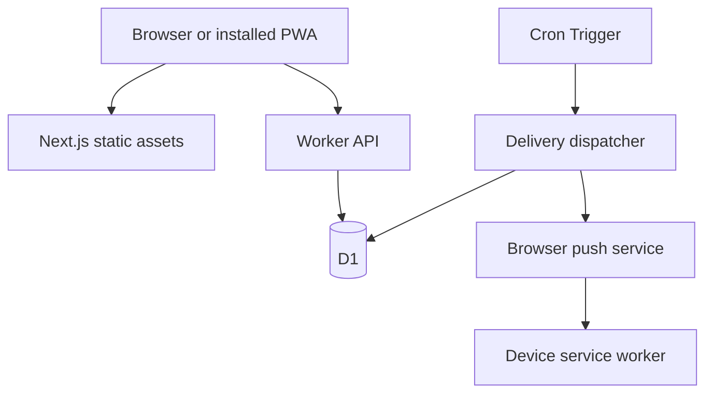

# Architecture

Next.js exports the frontend to static assets. Cloudflare serves these directly and routes `/api/` to the Worker. The Worker owns authentication, validation, persistence and notification dispatch.

## Authentication

One password grants access to the deployment's entire dataset. There is no tenant or public registration system. HMAC-signed sessions expire after seven days. The signing key depends on both the server secret and password verifier, so changing the password invalidates existing sessions.

## Data

Reminders store UTC due timestamps plus an IANA timezone. Recurring series are materialized into separate occurrences in the browser and inserted atomically. Month/year recurrence uses Gregorian dates with month-end clamping and preserves the original anchor day. Weekly recurrence retains local time across daylight-saving transitions.

A record version guards concurrent server updates. A separate notification revision changes when the title, timing or completion reset requires a new alert. Records synchronize on reload, not through realtime subscriptions.

## Delivery

The dispatcher records a heartbeat, materializes eligible delivery rows, claims a bounded batch with leases, sends encrypted messages and records acceptance or a retry time. Its delivery key is reminder ID, device ID and notification revision. Old delivery records are periodically removed.

Provider acceptance is not proof of display. A crash after sending but before recording success can produce a duplicate; tags reduce visible duplication.

## Frontend modules

| Module             | Responsibility                            |
| ------------------ | ----------------------------------------- |
| `Dashboard.tsx`    | Forms, reminder actions and summary views |
| `Calendar.tsx`     | Month navigation and date filtering       |
| `PushStatus.tsx`   | Device subscription and test controls     |
| `lib/messages.ts`  | English and Persian strings               |
| `lib/reminders.ts` | Series generation and ICS export          |

The app does not move money, access bank accounts, or send email/SMS. Deployment owners manage their accounts, backups and device permissions.
